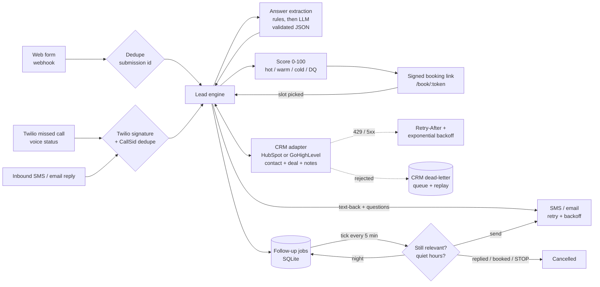

# AI Lead Qualification: Missed Call Text-Back → HubSpot / GoHighLevel → Booked

**Every web-form lead and missed call gets a text within seconds. An AI assistant asks four qualifying questions over SMS (or email), scores the lead, updates the contact and deal in HubSpot or GoHighLevel, sends a booking link, and follows up until the lead replies, books or says STOP.**

    


## The problem

"Missed call text-back", "AI SMS lead qualification" and "GoHighLevel / HubSpot automation" are posted on Upwork every day, mostly by home-service businesses (HVAC, roofing, med spas, solar) and the agencies that serve them. Their pain is always the same:

- Leads go cold in minutes, and nobody answers the phone after 5pm or on a job site.
- The CRM is a mess: duplicates, no stage, no idea which leads are worth a call back.
- Follow-up is manual, so it doesn't happen. Or it keeps texting people who already booked, or who said STOP.
- Off-the-shelf "AI bots" invent answers and can't be tested.

## The solution

1. **Lead arrives** from a web form (`POST /webhooks/form`, any form builder or Zapier/Make/n8n), a **missed call** (Twilio voice status callback), or a text to the business number.
2. **Instant text-back** in under a second, deduplicated by Twilio `CallSid` / `MessageSid` / form submission id.
3. **AI qualification over SMS or email**: service type, timeline, ZIP code, property owner. Rules handle "2", "asap" and "11211" for free. An OpenAI-compatible model handles the messy replies, and its answers are validated against an allowed list. Unclear twice, or "call me", hands the lead to a person.
4. **Transparent score** (0–100, hot/warm/cold/disqualified) with each point explained in a CRM note. Out-of-area ZIPs and renters asking for installs are disqualified politely.
5. **CRM sync** through an adapter: contact upsert (email, or phone search for missed calls), deal/opportunity created then moved through stages, notes with the transcript summary. **HubSpot v3** and **GoHighLevel (LeadConnector v2)** are both included and tested against a mock with the real URLs and payloads.
6. **Booking link**: signed, expiring URL to a mobile booking page with 2-hour windows in the business time zone. Booking moves the deal to "appointment booked" and schedules a reminder.
7. **Follow-up sequences** (2h, 24h, 72h by email, then close) that **stop the moment the lead replies, books or opts out**, and never text during quiet hours.

## Architecture



## Reliability and compliance

| Risk | What this project does |
|---|---|
| Twilio retries a webhook, form double-submits | Idempotency keys (`CallSid`, `MessageSid`, submission id or content hash). One lead, one text |
| Forged webhooks | `X-Twilio-Signature` HMAC-SHA1 check against `PUBLIC_URL`; optional `X-Webhook-Secret` on forms |
| Texting someone who replied, booked or said STOP | Replies cancel pending nudges; booking cancels everything; every job re-checks the lead's stage right before sending |
| STOP / opt-out (TCPA) | STOP, UNSUBSCRIBE, CANCEL, QUIT... set `opted_out`, cancel all jobs, flag `sms_opt_out` in the CRM. Nothing is sent again until START |
| Texting at 2am | Quiet hours in the business time zone (default 20:00–08:00). Jobs due at night are deferred to the morning |
| HubSpot / GHL rate limits (429) and 5xx | Retries with exponential backoff and jitter, `Retry-After` honoured |
| CRM rejects a record (bad email, missing field) | The lead still gets texted; the sync goes to a **dead-letter queue**. `npm run dlq`, then `npm run replay -- all` after fixing. Replays never create duplicates |
| Duplicate CRM contacts | Upsert by email (HubSpot batch upsert / GHL `contacts/upsert`), phone search for missed calls, deal ID stored on the lead |
| Twilio outage | Sends retried; a failed follow-up is rescheduled 15 minutes later, up to 3 attempts |
| AI makes something up | The model only fills one of a fixed set of values per question. Anything else becomes a re-ask, then a human handoff. The model never writes customer-facing text |
| Prompt injection in an SMS | Customer text is treated as data; the output is validated against an allow-list, so "ignore your instructions" can't change the flow |
| Reminder after the visit | Reminders are skipped if the appointment time has passed |
| Booking link tampering / old links | HMAC-signed, 14-day expiry; slots are re-checked and unique per time window |
| Leaking phone numbers in logs | Structured JSON logs mask numbers (`+121***42`) |

## Quick start (no API keys, no Twilio account)

```bash
npm install
cp .env.example .env

npm test                  # 35 tests (vitest)
npm run typecheck         # strict TypeScript
./scripts/demo.sh         # full story: 11 leads over 4 simulated days, HubSpot + GoHighLevel
./scripts/serve.sh        # webhooks + dashboard on http://localhost:8900/admin
```

Try it by hand while `serve.sh` is running (signature checks need `VALIDATE_TWILIO_SIGNATURE=false` for raw curl):

```bash
curl -X POST localhost:8900/webhooks/form -H 'content-type: application/json' \
  -d '{"name":"Jane Doe","phone":"(212) 555-0142","email":"jane@example.com","message":"AC blowing warm air"}'
curl -X POST localhost:8900/webhooks/twilio/sms -d 'MessageSid=SM1&From=%2B12125550142&Body=2'
```

### Going live

```env
PUBLIC_URL=https://leads.yourdomain.com
TWILIO_ACCOUNT_SID=AC...                 # Voice: status callback -> /webhooks/twilio/voice-status
TWILIO_AUTH_TOKEN=...                    # Messaging: incoming webhook -> /webhooks/twilio/sms
TWILIO_FROM_NUMBER=+1...
CRM_PROVIDER=gohighlevel                 # or hubspot
CRM_MOCK=false
GHL_TOKEN=...  GHL_LOCATION_ID=...  GHL_PIPELINE_ID=...
OPENAI_API_KEY=sk-...                    # optional; any OpenAI-compatible endpoint via OPENAI_BASE_URL
```

Map your pipeline stage IDs in `src/crm/hubspot.ts` / `src/crm/gohighlevel.ts` (see [HANDOFF.md](HANDOFF.md)).

## Screenshots

| Lead dashboard | Missed-call conversation | Booking page |
|---|---|---|
|  |  |  |

Captured with Playwright (`python3 scripts/screenshot.py`).

## Demo output

From `./scripts/demo.sh` (full output in [`docs/demo-output.txt`](docs/demo-output.txt)):

```
=== 2. Missed call -> text-back -> booked
  forged Twilio webhook -> HTTP 403 (rejected)
  missed call webhook -> HTTP 200
  Twilio retries the same webhook -> HTTP 200 (deduped by CallSid)
  SMS -> +17185550199: Hi Marcus, this is Atlas Heating & Cooling. Sorry we missed your call! ...
  +17185550199 replies: "need a new furnace, ours is 20 years old"   ... "1" ... "my zip is 11211" ... "y"
  Lead opens /book/..., picks Tue, Nov 17, 1:00 PM -> HTTP 200
  stage=booked score=100 | deal amount $8500
=== 3. Reply mid-sequence stops the follow-ups
  3 pending nudges cancelled on reply; a fresh timer started for the next question
=== 4. STOP is honoured everywhere
  stage=opted_out | pending jobs=0 | CRM sms_opt_out=true | no reply sent
=== 6. HubSpot rate limit burst + rejected record
  3x HTTP 429 -> retried with Retry-After (waits: 1000ms, 1000ms, 1000ms)
  HubSpot 400 INVALID_EMAIL -> lead still texted, sync parked in DLQ -> replay after the fix -> synced
=== 7. Evening missed call, nobody replies: quiet hours + full sequence
  [Tue, Nov 17, 9:30 PM ] tick -> sent 0, deferred 5
  [Wed, Nov 18, 8:00 AM ] tick -> sent 5
  ...
  Priya: stage=no_response | HubSpot stage closedlost
=== 9. Same engine against GoHighLevel
  opportunity ghl_o_102: stage_new -> stage_qualified | $450 | status open
```

## Project structure

```
src/
  engine.ts         intake -> questions -> score -> CRM -> booking -> follow-up sequences (stop-on-reply, quiet hours)
  qualify/          questions.ts, extract.ts (rules + validated LLM), score.ts (explainable points)
  crm/              types.ts (adapter), hubspot.ts, gohighlevel.ts, mock.ts (real URLs/payloads + 429/5xx/400 faults)
  twilio.ts         signature validation, missed-call detection, Twilio + Resend senders and mocks
  booking.ts        signed links, slots in the business time zone
  store.ts          SQLite (node:sqlite): leads, messages, webhook keys, jobs, CRM dead letters, appointments
  app.ts            wiring + HTTP server (webhooks, /book/:token, /admin)
  views.ts          dashboard, lead transcript, booking page (server-rendered HTML)
  cli.ts            serve | tick | dlq | replay
scripts/            demo.ts, demo.sh, serve.sh, screenshot.py
tests/              35 tests: unit, engine flows, HTTP server
```

## Tech

TypeScript (strict), Node 22.13+ (`node:http`, `node:sqlite`), zod, vitest, tsx. Twilio, Resend, HubSpot CRM v3, GoHighLevel API v2, any OpenAI-compatible LLM. Playwright for screenshots. No framework, no database server.

## License

MIT, © 2026 Taha Elkarroumy
